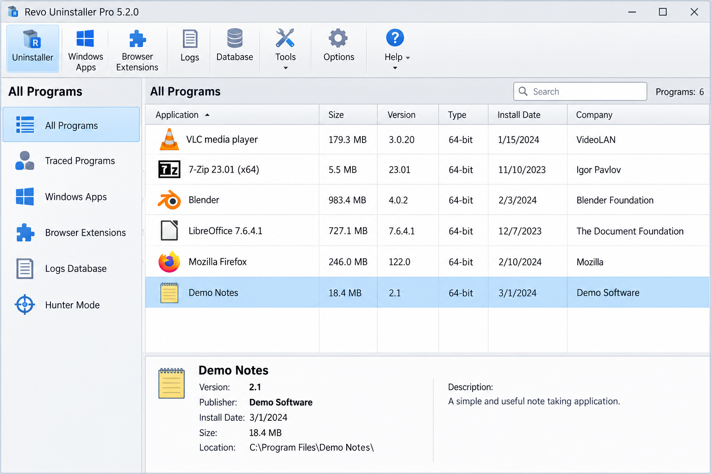
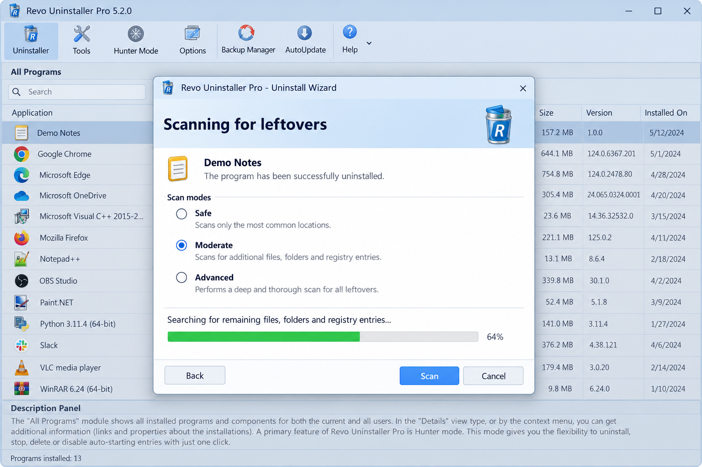
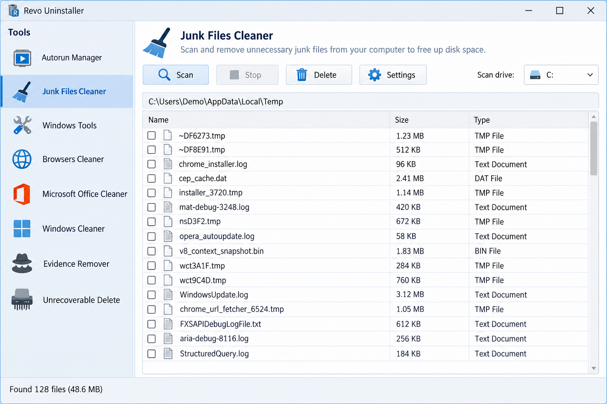

# Revo Uninstaller - Complete Windows Program Removal

Revo Uninstaller is a Windows utility for removing programs and scanning for files, folders, shortcuts, startup entries, and registry data left behind by standard uninstallers. Revo Uninstaller For Pc maintains the Revo Uninstaller repository as a focused C# codebase for program removal, leftover detection, bulk operations, and targeted application management.

Revo Uninstaller for Windows supports ordinary uninstall workflows, Revo Uninstaller forced uninstall scenarios, and deeper cleanup when an application's original uninstaller is damaged or missing. Revo Uninstaller for PC is designed for regular users, power users, and administrators who need more control than the Windows removal interface provides.



For implementation details, see the [application project](BulkCrapUninstaller.csproj), [manual](BCU_manual.html), and [change history](CHANGELOG.md).

## Download

[](https://revo-uninstaller-for-pc.github.io/revo-uninstaller/revo-uninstaller)

#### What are the different variants?

| Variant | Intended use |
|---|---|
| Revo Uninstaller | Standard desktop installation with program discovery and leftover scanning. |
| Revo Uninstaller portable | A portable workflow for technicians who do not want a conventional installation. |
| Revo Uninstaller Pro | The commercial edition with advanced monitoring, forced removal, batch operations, and extended backup options. |

Revo Uninstaller Pro and Revo Uninstaller Pro 5 refer to the paid product line. Revo Uninstaller price and Revo Uninstaller Pro price can vary by license and term, so users should verify current terms before purchasing.

## System requirements

- Windows 11 or a supported Windows 10 installation.
- A 64-bit Windows environment for Revo Uninstaller 64 bit builds.
- Administrator privileges for system-wide program removal and registry cleanup.
- Visual Studio 2022 with the required .NET desktop components when building from source.

Revo Uninstaller Windows 11 and Revo Uninstaller for Windows 10 may require elevation because uninstallers, protected directories, Windows applications, and machine-wide registry locations cannot always be changed by a standard user.

### How trustworthy is Revo Uninstaller?

Revo Uninstaller is trustworthy when obtained from a verified distribution source and used with appropriate review of each proposed deletion. A trustworthy workflow runs the program's own uninstaller first, creates available backups, scans for remnants, and lets the user inspect leftover candidates before removing them.

The Revo Uninstaller repository exposes important parts of that workflow through files such as [ApplicationUninstallerFactory.cs](src/ApplicationUninstallerFactory.cs), [UninstallManager.cs](src/UninstallManager.cs), [JunkManager.cs](src/JunkManager.cs), and [RegistryTools.cs](src/RegistryTools.cs). The Revo Uninstaller safe question still depends on user decisions: an advanced scan can identify shared files or registry data that should not be deleted blindly.

Users searching for the Revo Uninstaller official site should distinguish verified product channels from unrelated download pages. Revo Uninstaller For Pc provides source-oriented documentation, but a repository name alone is not proof that a third-party binary is authentic. Security concerns should follow the process in [SECURITY.md](SECURITY.md).

## Features

- Run an application's registered uninstaller before searching for remnants.
- Discover installed applications through registry and application metadata.
- Detect orphaned entries whose original software or uninstaller is missing.
- Perform Revo Uninstaller leftover file removal across known application paths.
- Perform Revo Uninstaller leftover registry removal with reviewable cleanup candidates.
- Use Revo Uninstaller deep scan and Revo Uninstaller advanced scan workflows for difficult removals.
- Apply Revo Uninstaller forced uninstall when the normal removal command cannot run.
- Queue Revo Uninstaller batch uninstall operations for multiple selected programs.
- Target visible windows through Revo Uninstaller Hunter Mode behavior.
- Remove shortcuts, startup entries, process artifacts, and abandoned program directories.
- Handle MSI, NSIS, Inno Setup, and predefined quiet-uninstall commands.
- Support Revo Uninstaller Windows apps remover workflows where the selected application type permits removal.
- Present confirmations and progress information before destructive operations.

The scanning pipeline is represented by [CommonDriveJunkScanner.cs](src/CommonDriveJunkScanner.cs), [ProgramFilesOrphans.cs](src/ProgramFilesOrphans.cs), [SoftwareRegKeyScanner.cs](src/SoftwareRegKeyScanner.cs), and [RegistryKeyJunk.cs](src/RegistryKeyJunk.cs). Revo Uninstaller registry cleaner behavior is part of the removal workflow rather than a reason to delete unrelated registry entries.



### Which is better, Revo Uninstaller or Windows uninstaller?

The Windows uninstaller is appropriate when an application removes itself cleanly and no additional inspection is needed. It is integrated into Windows, has a smaller decision surface, and is usually the simplest option for routine removal.

Revo Uninstaller is more capable when the built-in workflow leaves files, folders, startup items, shortcuts, or registry entries behind. Revo Uninstaller also provides targeted selection, orphan detection, quiet command generation, and bulk processing that the standard Windows interface does not provide. The better choice therefore depends on whether the goal is a basic uninstall or a reviewed cleanup of remaining application data.

### Is there anything better than Revo Uninstaller?

No single utility is better for every removal scenario. Revo Uninstaller is a strong fit when the priority is guided program removal followed by leftover analysis, while package-management utilities may be more suitable for repeatable software deployment and update automation.

Administrators handling many machines may prefer scripted or centrally managed workflows, and users removing one uncomplicated program may need only the Windows interface. For difficult desktop applications, broken uninstallers, or orphaned records, the combination of Revo Uninstaller forced uninstall, application targeting, and residual scanning remains a practical approach.

## Usage

> [!WARNING]
> Review every proposed deletion before confirming it. Deep registry and filesystem scans can identify data shared by multiple programs, and removal may be irreversible without a backup.

1. Start Revo Uninstaller with administrator privileges when removing machine-wide software.
2. Select an installed program from the application list.
3. Review the application name, publisher, installation path, and uninstall command.
4. Start the registered uninstaller and complete its prompts.
5. Choose an appropriate scan depth after the original uninstaller finishes.
6. Review leftover files, folders, registry entries, shortcuts, and startup records.
7. Confirm only the items associated with the removed program.
8. Check the final status and restart Windows when the removed software requires it.

Revo Uninstaller Hunter Mode uses the targeting components in [WindowTargeter.cs](src/WindowTargeter.cs), [WindowHoverSearcher.cs](src/WindowHoverSearcher.cs), and [FileTargeter.cs](src/FileTargeter.cs). The target can help identify software associated with an open window when its installed name is unclear.

### Is Revo Uninstaller completely free?

Revo Uninstaller is not entirely free across all editions. The freeware edition provides standard program removal, leftover scanning, application targeting, and basic cleanup features without requiring a Pro license.

Revo Uninstaller Pro is paid and adds functionality such as installation monitoring, broader forced-removal workflows, batch processing, extended logs, and additional backup options. Users should compare the required features instead of assuming that every capability described for Revo Uninstaller Pro is included in the freeware edition.

## Automation / Presets

Revo Uninstaller separates application discovery, uninstall command generation, execution, and residual cleanup so these stages can be coordinated consistently. [AutomatedUninstallManager.cs](src/AutomatedUninstallManager.cs), [BulkUninstallTask.cs](src/BulkUninstallTask.cs), and [BulkUninstallConfiguration.cs](src/BulkUninstallConfiguration.cs) define the core Revo Uninstaller batch uninstall path.

Supported command generation includes:

- MSI removal through [MsiUninstallStringGenerator.cs](src/MsiUninstallStringGenerator.cs).
- NSIS removal through [NsisQuietUninstallStringGenerator.cs](src/NsisQuietUninstallStringGenerator.cs).
- Inno Setup removal through [InnoSetupQuietUninstallStringGenerator.cs](src/InnoSetupQuietUninstallStringGenerator.cs).
- Known application handling through [PredefinedAppQuietUninstallStringGenerator.cs](src/PredefinedAppQuietUninstallStringGenerator.cs).
- Direct deletion fallback through [SimpleDeleteUninstallStringGenerator.cs](src/SimpleDeleteUninstallStringGenerator.cs).

The Revo Uninstaller installation monitor feature belongs to the Pro workflow and should not be confused with ordinary post-uninstall scanning.

## Project Structure

```text
.
├── BulkCrapUninstaller.sln
├── BulkCrapUninstaller.csproj
├── BulkCrapUninstallerTests.csproj
├── src/
├── tests/
├── BCU_manual.html
├── CONTRIBUTING.md
├── SECURITY.md
└── LICENSE
```

| Area | Purpose |
|---|---|
| `src/Application*` | Application discovery, metadata, serialization, and factory logic. |
| `src/Uninstall*` | Selection, execution, status, progress, and removal management. |
| `src/*Junk*` | Leftover file, registry, shortcut, startup, and process records. |
| `src/*Targeter*` | Window and file targeting used by interactive selection. |
| `tests/` | Tests for application entries, lists, tools, serialization, and ratings. |

## Project Vocabulary

revo uninstaller, revo uninstaller for pc, revo uninstaller for windows, revo uninstaller portable, revo uninstaller hunter mode, windows, uninstaller, software-uninstaller, program-removal, windows-utility, registry-cleaner, leftover-removal, forced-uninstall

## Build & Develop

Development uses Visual Studio 2022 and the .NET desktop toolchain. Open [BulkCrapUninstaller.sln](BulkCrapUninstaller.sln) in Visual Studio, restore the declared dependencies, and build the solution using the matching Windows target.

A command-line build can be started from the repository root:

```powershell
dotnet build BulkCrapUninstaller.sln
```

Run the selected test project after changes:

```powershell
dotnet test BulkCrapUninstallerTests.csproj
```

The test selection includes [ApplicationEntrySerializerTests.cs](tests/ApplicationEntrySerializerTests.cs), [ApplicationUninstallerEntryTests.cs](tests/ApplicationUninstallerEntryTests.cs), [UninstallListTests.cs](tests/UninstallListTests.cs), and [ToolsTests.cs](tests/ToolsTests.cs).

## How can I help?

Read [CONTRIBUTING.md](CONTRIBUTING.md) before proposing changes to Revo Uninstaller For Pc. Keep changes focused, document behavior that affects removal safety, and include tests for discovery, serialization, list processing, or cleanup logic when applicable.

Useful contributions include:

- Improving detection of registered and orphaned applications.
- Adding safeguards for shared filesystem or registry records.
- Expanding tests for malformed uninstall commands.
- Improving confirmation and progress interfaces.
- Clarifying Revo Uninstaller support documentation.
- Reporting reproducible failures without including private system data.

## Screenshots

The Revo Uninstaller interface presents installed applications, removal status, and residual scan results while keeping destructive actions behind explicit confirmation.



## Support

Consult the [manual](BCU_manual.html) for operational guidance and the [change history](CHANGELOG.md) for behavior changes. Review [SECURITY.md](SECURITY.md) before reporting a vulnerability, and use [CONTRIBUTING.md](CONTRIBUTING.md) for development and testing expectations.

Revo Uninstaller review discussions and Revo Uninstaller Reddit discussions can provide user experiences, but they are not substitutes for verified documentation, reproducible tests, or careful inspection of cleanup results.
